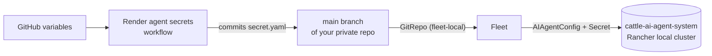

# Rancher AI agents with Fleet

A ready-to-use [Rancher Fleet](https://fleet.rancher.io) repository of custom
**Rancher AI agents** (`AIAgentConfig` resources) that run next to the built-in
Rancher, Continuous Delivery, and Cluster Provisioning agents.

Copy it into your own **private** repository, set a few GitHub variables, and
point Fleet at it. Fleet does all the deploying. GitHub Actions only renders the
agents' credentials into your private repository and never touches your cluster.

## Agents

### SUSE products — [`suse/`](suse)

| Agent | MCP server | Auth | What it does |
|-------|------------|------|--------------|
| [SUSE Application Collection](suse/appco) | Hosted by SUSE | BASIC | Hardened images and charts, SBOMs, CVE data, migrations to AppCo |
| [SBOMscanner](suse/sbomscanner) | In-cluster ([SBOMscanner](https://documentation.suse.com/cloudnative/vulnerability-scanner/latest/en/user-guide/mcp-server.html)) | BASIC + CA | Registry and workload vulnerability reports, scan jobs, VEX |

### Third-party — [`third-party/`](third-party)

| Agent | MCP server | Auth | What it does |
|-------|------------|------|--------------|
| [Argo CD](third-party/argocd) | [mcp-for-argocd](https://github.com/argoproj-labs/mcp-for-argocd) | HEADER | Read-only Argo CD inventory, sync/health, drift, troubleshooting |
| [GitHub](third-party/github) | [GitHub remote MCP](https://github.com/github/github-mcp-server) | HEADER (PAT) | Repos, PRs, issues, Actions; proposes GitOps changes as PRs |
| [Kubernetes MCP](third-party/kubernetes-mcp) | [kubernetes-mcp-server](https://github.com/containers/kubernetes-mcp-server) | NONE | Read-only, low-level introspection of the Rancher local cluster |
| [OVHcloud Dedicated Server](third-party/ovh-dedicated-server) | [OVHcloud MCP](https://labs.ovhcloud.com/en/mcp-server/) | OAUTH2 | Bare-metal inventory, tasks, interventions, reboots (human-validated) |
| [OVHcloud Network](third-party/ovh-network) | [OVHcloud MCP](https://labs.ovhcloud.com/en/mcp-server/) | OAUTH2 | IPs, Edge Network Firewall, DDoS mitigation; files firewall requests instead of changing rules |
| [Atlassian Rovo](third-party/rovo) | [Atlassian Rovo MCP](https://support.atlassian.com/atlassian-rovo-mcp-server/docs/getting-started-with-the-atlassian-remote-mcp-server/) | BASIC | Jira and Confluence; opens network/firewall request tickets |

Every agent has a detailed **Agent Profile** (`description`, used by the
supervisor to route prompts) and **Guidelines** (`systemPrompt`). Tools that
change anything are listed in `humanValidationTools`, so the user approves them
in the chat first.

The agents hand work to each other. For example, OVHcloud Network diagnoses a
blocked flow and Atlassian Rovo opens the firewall ticket. AppCo asks the
built-in Rancher and Continuous Delivery agents to check pull secrets and GitOps
ownership before proposing an image change.

This repository does not install MCP servers. Each agent's README links to the
upstream documentation and only adds notes specific to Rancher AI.

## How it works

```
suse/appco/
├── fleet.yaml           Fleet bundle: namespace cattle-ai-agent-system
├── aiagentconfig.yaml   the agent; edit it in your copy (URLs, enabled, ...)
├── secret.yaml.tpl      auth Secret with ${GITHUB_VARIABLE} placeholders
├── secret.yaml          rendered by GitHub Actions in your private copy
├── .fleetignore         keeps README.md and *.tpl out of the bundle
└── README.md
```



1. The **Render agent secrets** workflow fills each `secret.yaml.tpl` from your
   GitHub variables and commits the resulting `secret.yaml` to `main`. An agent
   is rendered only when all of its required variables are set.
2. A Fleet **GitRepo** in the `fleet-local` workspace watches `main`. Each agent
   folder is one bundle containing `aiagentconfig.yaml` and `secret.yaml`.
3. Rancher AI picks up the `AIAgentConfig`s in `cattle-ai-agent-system`.

> [!WARNING]
> `secret.yaml` holds credentials in plain text, and so do GitHub variables
> (anyone with read access to the repository can see them). Use a **private**
> repository with restricted access. The workflow refuses to run in a public
> repository, and CI fails if a `secret.yaml` is committed here.

## Quick start

**Prerequisites:** Rancher with Rancher AI installed, and the MCP servers you
want to use reachable from the Rancher local cluster (see each agent's README).

1. **Create your private copy.** Click **Use this template → Create a new
   repository**, then choose **Private**. Don't use *Fork*: a fork of a public
   repository is always public.

2. **Choose your agents.** Delete the agent folders you don't need, or simply
   leave them out of the GitRepo `paths` (step 5).

3. **Adjust the agents.** Edit `aiagentconfig.yaml` where its README says to.
   For example, the Argo CD MCP URL is marked `# EDIT`, and the Rovo Jira
   project key is in the Guidelines.

4. **Set the credentials.** Under **Settings → Secrets and variables → Actions →
   Variables**, add the variables listed in each agent's README. Then run
   **Actions → Render agent secrets** and check the summary:
   ```
   rendered suse/appco/secret.yaml
   skipped  third-party/argocd (not configured: ARGOCD_MCP_TOKEN)
   ```
   The workflow also runs on every push that changes a template. Run it again
   by hand after you change a variable.

5. **Point Fleet at the repository.** In Rancher, open **Continuous Delivery →
   Git Repos**, select the `fleet-local` workspace, and create a GitRepo:
   - **Repository URL**: your private repository, branch `main`.
   - **Authentication**: HTTP basic auth with a read-only token (a fine-grained
     PAT with *Contents: read*).
   - **Paths**: the agent folders you want, e.g. `suse/appco`, `third-party/rovo`.

   Or apply [`examples/gitrepo.yaml`](examples/gitrepo.yaml) after editing it.

6. **Check:**
   ```bash
   kubectl get gitrepo -n fleet-local
   kubectl get aiagentconfig -n cattle-ai-agent-system
   ```

## Migrating agents created in the UI
Fleet takes over (`helm.takeOwnership`) and overwrites any agent with the same
`metadata.name` that you created by hand in the Rancher UI. Back them up first:

```bash
kubectl get aiagentconfig -n cattle-ai-agent-system <name> -o yaml > backup-<name>.yaml
```

## Getting updates
To pull improvements from this repository into your copy:

```bash
git remote add upstream https://github.com/jp-gouin/rancher-ai-agents-fleet.git
git fetch upstream && git merge upstream/main --allow-unrelated-histories
```

## Contributing an agent
See [docs/adding-an-agent.md](docs/adding-an-agent.md): the folder layout,
`secret.yaml.tpl` syntax, the Secret formats Rancher AI expects, and how to
write a good Agent Profile and Guidelines. `./scripts/lint.sh` runs the same
checks as CI. Never include a rendered `secret.yaml` in a pull request.

## License
[Apache 2.0](LICENSE)
