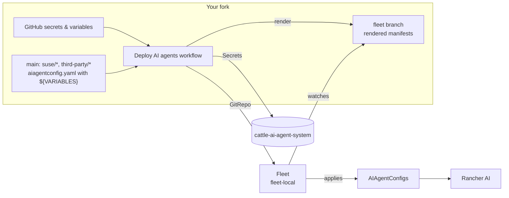

# Rancher AI agents with Fleet

A ready-to-fork [Rancher Fleet](https://fleet.rancher.io) repository of custom
**Rancher AI agents** (`AIAgentConfig` resources) that run next to the built-in
Rancher, Continuous Delivery, and Cluster Provisioning agents.

Fork it, set a few GitHub secrets and variables, run one workflow, and Fleet
keeps the agents in sync with your fork. Credentials never go into git.

## Agents

### SUSE products — [`suse/`](suse)

| Agent | MCP server | Auth | What it does |
|-------|------------|------|--------------|
| [SUSE Application Collection](suse/appco) | Hosted by SUSE | BASIC | Hardened images and charts, SBOMs, CVE data, migrations to AppCo |
| [SBOMscanner](suse/sbomscanner) | In-cluster ([SBOMscanner](https://documentation.suse.com/cloudnative/vulnerability-scanner/latest/en/user-guide/mcp-server.html)) | BASIC + CA | Registry and workload vulnerability reports, scan jobs, VEX |

### Third-party — [`third-party/`](third-party)

| Agent | MCP server | Auth | What it does |
|-------|------------|------|--------------|
| [Argo CD](third-party/argocd) | [mcp-for-argocd](https://github.com/argoproj-labs/mcp-for-argocd) | HEADER | Read-only Argo CD inventory, sync/health, drift, troubleshooting |
| [GitHub](third-party/github) | [GitHub remote MCP](https://github.com/github/github-mcp-server) | HEADER (PAT) | Repos, PRs, issues, Actions; proposes GitOps changes as PRs |
| [Kubernetes MCP](third-party/kubernetes-mcp) | [kubernetes-mcp-server](https://github.com/containers/kubernetes-mcp-server) | NONE | Read-only, low-level introspection of the Rancher local cluster |
| [OVHcloud Dedicated Server](third-party/ovh-dedicated-server) | [OVHcloud MCP](https://labs.ovhcloud.com/en/mcp-server/) | OAUTH2 | Bare-metal inventory, tasks, interventions, reboots (human-validated) |
| [OVHcloud Network](third-party/ovh-network) | [OVHcloud MCP](https://labs.ovhcloud.com/en/mcp-server/) | OAUTH2 | IPs, Edge Network Firewall, DDoS mitigation; files firewall requests instead of changing rules |
| [Atlassian Rovo](third-party/rovo) | [Atlassian Rovo MCP](https://support.atlassian.com/atlassian-rovo-mcp-server/docs/getting-started-with-the-atlassian-remote-mcp-server/) | BASIC | Jira and Confluence; opens network/firewall request tickets |

Every agent has a detailed **Agent Profile** (`description`, used by the
supervisor to route prompts) and **Guidelines** (`systemPrompt`). Tools that
change anything are listed in `humanValidationTools`, so the user approves them
in the chat first.

The agents hand work to each other. For example, OVHcloud Network diagnoses a
blocked flow and Atlassian Rovo opens the firewall ticket. AppCo asks the
built-in Rancher and Continuous Delivery agents to check pull secrets and GitOps
ownership before proposing an image change.

This repository does not install MCP servers. Each agent's README links to the
upstream documentation and only adds notes specific to Rancher AI.

## How it works



- Each agent folder holds a plain `aiagentconfig.yaml`. Settings that are not
  secret are written as `${VARIABLE}` or `${VARIABLE:-default}` placeholders.
- `agent.yaml` maps **GitHub secret names** to the keys of the agent's
  Kubernetes Secret. It never contains values.
- The **Deploy AI agents** workflow:
  1. creates the Secrets in `cattle-ai-agent-system`;
  2. fills the placeholders from your **GitHub variables** and pushes the result
     to the `fleet` branch;
  3. registers a Fleet `GitRepo` in `fleet-local` (the Rancher local cluster)
     that watches that branch, limited to the agents in `AGENTS`.
- Every push to `main` that changes an agent re-renders the `fleet` branch, and
  Fleet applies the change. This step needs no cluster access.

`AIAgentConfig`s always live in `cattle-ai-agent-system` on the Rancher local
cluster, so the namespace and Fleet workspace are fixed.

## Quick start

**Prerequisites**
- Rancher with Rancher AI installed.
- The MCP servers you want to use are reachable from the Rancher local cluster.
  See each agent's README.
- A kubeconfig for the Rancher local cluster that can manage Secrets in
  `cattle-ai-agent-system` and GitRepos in `fleet-local`, and reach the API from
  the GitHub runner. For private APIs, use a
  [self-hosted runner](https://docs.github.com/actions/hosting-your-own-runners)
  and set `RUNNER`.

**1. Fork** the repository, then enable workflows under **Actions**.

**2. Set the common settings** under **Settings → Secrets and variables → Actions**:

| Kind | Name | Required | Description |
|------|------|----------|-------------|
| Secret | `RANCHER_KUBECONFIG` | yes | Kubeconfig of the Rancher local cluster (raw YAML or base64) |
| Variable | `AGENTS` | yes | Agents to deploy, comma-separated (`appco,rovo`, `third-party/github`) or `all` |
| Secret | `FLEET_GIT_TOKEN` | private forks | Read-only token Fleet uses to clone the fork |
| Variable | `RUNNER` | no | Runner label (default `ubuntu-latest`) |
| Variable | `FLEET_BRANCH` | no | Branch for the rendered manifests (default `fleet`) |
| Variable | `GITREPO_NAME` | no | Fleet GitRepo name (default `rancher-ai-agents`) |
| Variable | `FLEET_REPO_URL` | no | Override the repository URL Fleet clones |

**3. Set each agent's secrets and variables**, as listed in the
**Configuration** table of its README. Most variables have sensible defaults.

**4. Deploy**: go to **Actions → Deploy AI agents → Run workflow**. Tick
**dry_run** first to see the rendered manifests, then run it for real.

```bash
kubectl get gitrepo -n fleet-local rancher-ai-agents
kubectl get aiagentconfig -n cattle-ai-agent-system
```

Run the workflow manually again after you change a **secret** or `AGENTS`.
Changes to variables or agent files are rendered on the next push to `main`, or
on any manual run.

### Running locally
```bash
export KUBECONFIG=~/.kube/rancher-local.yaml AGENTS=appco,rovo
export APPCO_USERNAME=... APPCO_PASSWORD=... ROVO_USERNAME=... ROVO_API_TOKEN=... ROVO_JIRA_PROJECT_KEY=NET
./scripts/deploy.sh secrets
./scripts/deploy.sh render ./rendered    # then push ./rendered to the fleet branch
./scripts/deploy.sh gitrepo
```
Add `DRY_RUN=true` to print the manifests instead (secret values are redacted).

## Migrating agents created in the UI
Fleet takes over (`helm.takeOwnership`) and overwrites any agent with the same
`metadata.name` that you created by hand in the Rancher UI. Back them up first:

```bash
kubectl get aiagentconfig -n cattle-ai-agent-system <name> -o yaml > backup-<name>.yaml
```

## Contributing an agent
See [docs/adding-an-agent.md](docs/adding-an-agent.md): the folder layout,
placeholder syntax, `agent.yaml` reference, secret formats Rancher AI expects,
and how to write a good Agent Profile and Guidelines. `./scripts/lint.sh` runs
the same checks as CI.

## Repository layout
```
suse/<agent>/            SUSE product agents      ┐ aiagentconfig.yaml, agent.yaml, README.md
third-party/<agent>/     third-party agents       ┘
scripts/deploy.sh        secrets | render | gitrepo
scripts/lint.sh          static checks used by CI
scripts/wire-secrets.sh  list agent secrets in the deploy workflow
docs/                    contributor guide
```

## Security notes
- Secrets exist only as GitHub encrypted secrets and Kubernetes Secrets. The
  workflow lists each secret explicitly. It does not use `toJSON(secrets)`,
  which GitHub holds for manual approval anyway.
- With HEADER auth, Rancher AI sends **every key** of the auth Secret as an HTTP
  header, so those Secrets contain only headers.
- CI rejects private IPs, wildcard-DNS hosts, certificates, private keys, and
  GitHub tokens.

## License
[Apache 2.0](LICENSE)
